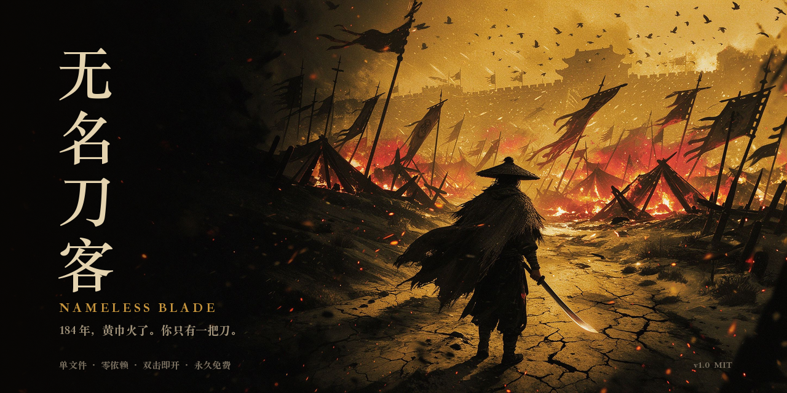
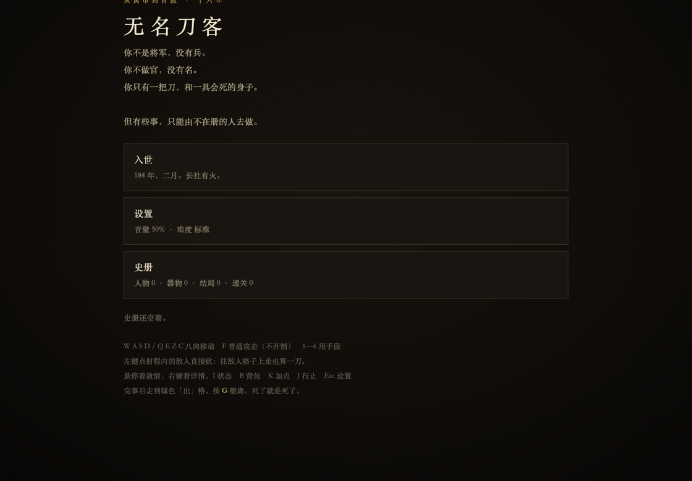
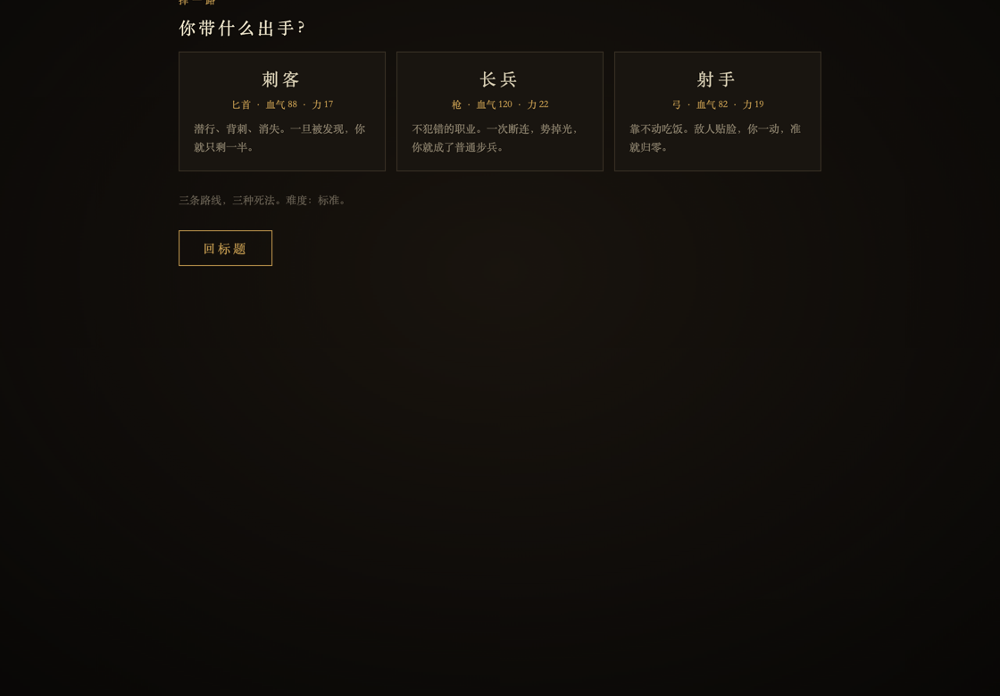
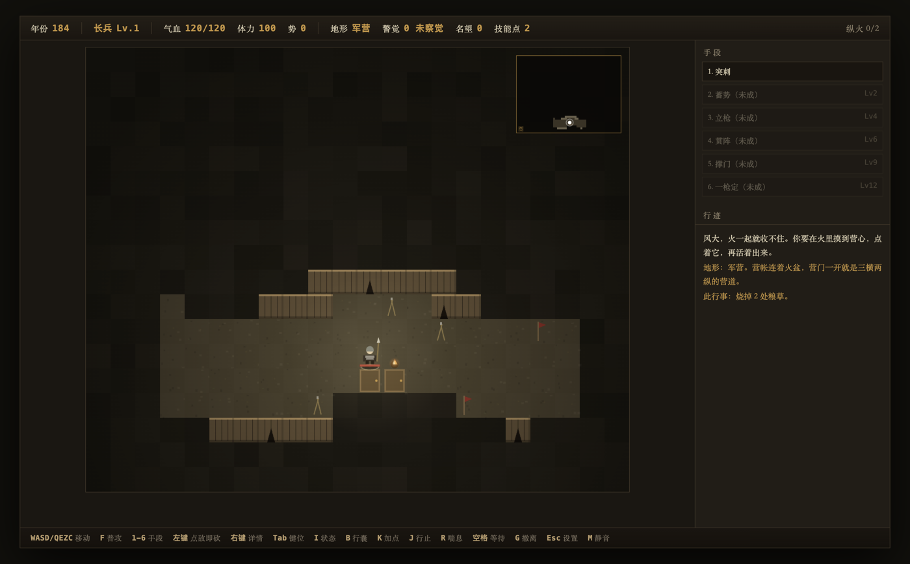
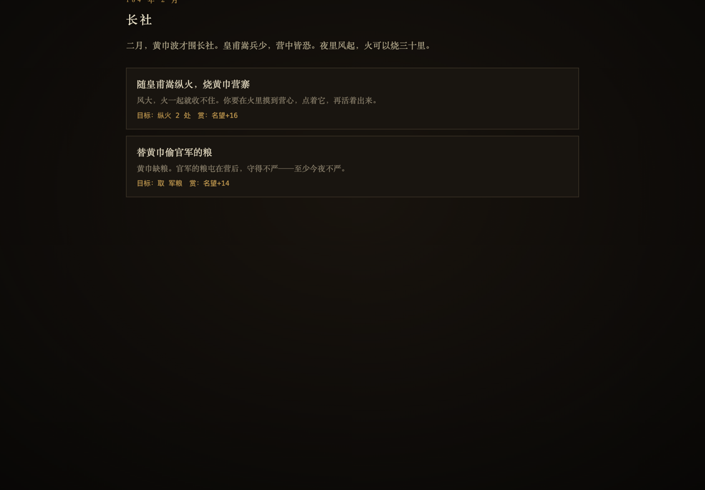

# 无名刀客 · 三国

**你不是将军，没有兵。你不做官，没有名。你只有一把刀，和一具会死的身子。**

一个 184 年开局、能一路杀到官渡的单文件回合制潜行刀战游戏。纯原生 JS + Canvas 手绘，**零依赖、零安装、双击就开**——同样一个 `index.html`，Mac、Windows、Linux 上跑的都是它。

<p>
  
  
  
  
  
</p>



> **永久免费，长期更新。** 不卖皮肤、不做内购、不加体力条。你提的意见会进下一个版本。

## 试玩 / Play

- **在线直接玩**（手机只是看，操作要键盘）：https://stan-hypnos.github.io/wuming-daoke/
- **本地玩**：下载 `index.html`，双击。没了。



## 三条路线，三种死法

| 职业 | 兵器 | 活法 |
| --- | --- | --- |
| **刺客** | 匕首 | 潜行、背刺、消失。一旦被发现，你就只剩一半。 |
| **长兵** | 枪 | 不犯错的职业。一次断连，势掉光，你就成了普通步兵。 |
| **射手** | 弓 | 靠不动吃饭。敌人贴脸，你一动，准就归零。 |

三条路线各有 6 个手段，靠"势 / 暗劲 / 准"三种资源运转——不是冷却好了就按，是按错一次就白给。



## 敌人不是靶子

- **地图会咬人**：军营、城镇、皇宫、山道、渡口、粮仓六种场景；火盆会烧、草丛能藏、深水过不去、高地看得远。
- **杂兵分型**：刀兵力士枪兵弓手老卒守卫精锐纵火兵黄巾兵各有 AI，弓手会隔着你打，纵火兵真敢放火。
- **名将真的会动手**：华雄劈砍、吕布横扫、董卓砸地，蓄力一回合、第二回合落地，站错一格就是没了。
- **警觉会升级**：杀得越多，追你的人越狠；撤离前先想清楚还能不能撑下一波。



## 这局游戏不只有刀

- **词缀装备**：锋利、嗜血、破甲、迅捷、沉重、贯甲……十种词缀随机落在兵器甲胄上，营地还能"磨刀"再添一条。
- **十五个历史节点**：从长社之火到官渡，事件不是弹窗念白，是能改地图、改任务、改敌情的选择。


- **九条结局**：你做的每一件事，最后都会落到某一条上。
- **史册（永久进度）**：人物、器物、事件、战绩、结局五栏慢慢点亮；解锁新的起手兵器与挑战模式，但**不给属性加成**——老玩家不许凭累计碾压新手。
- **三档难度 + 挑战模式**：轻松看故事，苦战认真活，挑战模式敌人更硬、经验更高。
- **单槽存档**：每回合自动存，关掉浏览器回来还能接着死。

## 键位

```
W A S D / Q E Z C   八向移动          F   普攻（不消耗）
1 - 6               用手段            左键 点射程内敌人直接砍
右键              看详情            Tab  键位
I 状态   B 行囊   K 加点   J 行止   R 喘息   空格 等待
G 撤离（站在绿色「出」格）              Esc 设置   M 静音
```

死了就是死了。没有复活币。

## 提意见

想让这游戏更好玩，直接开 [Issue](https://github.com/stan-hypnos/wuming-daoke/issues)：

- **哪里不好玩**——哪一关最烦、哪个职业最废、哪个 Boss 最赖
- **哪里看不懂**——第一次进来不知道要干嘛，卡在哪一步
- **想要什么**——新职业、新场景、新结局、手机触屏操作，都可以提

写清楚"你怎么玩的、卡在哪、期望什么"，比一句"很好玩"有用一百倍。**合理的好点子会排进更新。**

## 开发

整个游戏就是 `index.html` 一个文件：`<style>` 里是纸色与排版，`<script>` 里是地图生成、AI、战斗结算、渲染、UI。改一行，刷新浏览器，立刻看到效果——不用构建、不用打包。

```bash
git clone https://github.com/stan-hypnos/wuming-daoke
open index.html          # macOS
start index.html         # Windows
```

## English

**Nameless Blade** — a single-file, zero-dependency turn-based stealth-blade roguelike set in 184 AD China. Three classes (assassin / spearman / archer), six tilesets, three named-warrior bosses (Hua Xiong / Lü Bu / Dong Zhuo), affix gear, fifteen historical events and nine endings. Hand-drawn with Canvas, no assets, no engine, no build step: double-click `index.html` and play. Play online: https://stan-hypnos.github.io/wuming-daoke/ — free forever, feedback welcome via Issues.

## License

MIT. 拿去改、拿去玩、拿去教别人写游戏都行。
